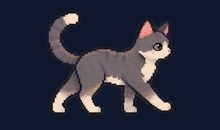

<div align="center">

# 🎮 PROA · Experiencia Interactiva

### Una escuela para descubrir, jugar y recorrer de otra manera.

🌅 **Un patio al atardecer** · 🐈 **Un gatito perdido** · 🧱 **Un mundo hecho de bloques**

[](https://alvaroespinozaproa.github.io/Experiencia-Interactiva/experiencia-interactiva/escape-proa/)

**[▶ Entrar a la experiencia](https://alvaroespinozaproa.github.io/Experiencia-Interactiva/experiencia-interactiva/)**

</div>

---

## ¿Qué es esto?

Esta es una parte de **PROA Web**, una página hecha para mostrar nuestra escuela, sus espacios y los proyectos que se hacen en ella. Para la presentación del evento quisimos ir un poco más allá de contar cómo es PROA: la idea fue que también se pudiera **jugar, explorar y aprender**.

Así se fue armando esta experiencia con varias propuestas distintas. Hay preguntas sobre la escuela, un desafío de HTML, un mundo de Minecraft y una pequeña aventura protagonizada por un gato. Cada una tiene su propio estilo, pero todas nacen del mismo lugar: mostrar PROA desde lo que hacemos y creamos.

<div align="center">


*El patio de Escape PROA, cuando empieza a caer el sol.*

</div>

## 🐈 Escape PROA · La historia del gatito

Un pequeño gato gris aparece perdido en un lugar que no conoce. Mientras cae la tarde, necesita encontrar las llaves para seguir su camino. Ahí entramos nosotros: hay que acompañarlo, observar el entorno y resolver los acertijos que se esconden en cada rincón.

La aventura pasa por el **patio, el pasillo y el taller**. Los objetos forman parte de los escenarios: un libro en un banco, un mecanismo de riego, una partitura o una pantalla pueden guardar una pista. No es solo encontrar una puerta; también se trata de prestar atención a lo que hay alrededor.

<details>
<summary>🐾 ¿Y cómo termina la historia? (contiene spoilers)</summary>

Después de atravesar las habitaciones y llegar a la salida, el gatito encuentra a alguien dispuesto a cuidarlo. Lo que empezó como una búsqueda termina convirtiéndose en el comienzo de una vida nueva, con compañía y un lugar seguro.

</details>

La idea fue ir puliendo el juego para que tuviera personalidad: movimientos del gato, escenas al atardecer, diálogos con aire cinematográfico y acertijos que se sintieran parte del lugar. Hubo muchas vueltas para acomodar los detalles, especialmente la ubicación de los objetos y sus interacciones.

**[🐾 Acompañar al gatito](https://alvaroespinozaproa.github.io/Experiencia-Interactiva/experiencia-interactiva/escape-proa/)**

---

## 🧱 PROA en bloques

¿Y si pudiéramos entrar a la escuela desde Minecraft? Acá está el recorrido por el mundo de PROA, con un tráiler, las instrucciones y el acceso a la carpeta del mapa.


Para jugar el mapa se indican la versión, los mods y las coordenadas dentro de la página. El mundo se descarga desde Google Drive.

**[⛏️ Ver el recorrido](https://alvaroespinozaproa.github.io/Experiencia-Interactiva/experiencia-interactiva/recorrido-en-bloques/)**

## 🧠 Otros desafíos

| Experiencia | ¿De qué se trata? |
| --- | --- |
| 🎤 **PROA: El desafío** | Un juego de preguntas para poner a prueba lo que sabemos sobre la escuela. |
| 💻 **Desafío HTML** | Encontrar parejas de etiquetas y definiciones, y después enfrentarse al test en modo virus. |
| 🐈 **Escape PROA** | Explorar, resolver acertijos y ayudar al gatito a encontrar el camino. |
| 🧱 **PROA en bloques** | Mirar el recorrido y descargar el mundo de Minecraft. |

**[✨ Elegir una experiencia](https://alvaroespinozaproa.github.io/Experiencia-Interactiva/experiencia-interactiva/)**

---

## 🛠️ Cómo está hecho

La versión de este repositorio está preparada como sitio estático para **GitHub Pages**, con HTML, CSS y JavaScript. También usa GSAP para algunas animaciones; los escenarios, imágenes y sonidos están en la carpeta `static`.

Para abrirlo localmente, serví la carpeta con un servidor web, por ejemplo:

```bash
python -m http.server 8000
```

Después entrá a `http://localhost:8000/`. El formulario de contacto y los menús PAICOR necesitan un servidor y una base de datos, así que no están habilitados en esta versión.

---

<div align="center">

**Hecho para mostrar que en PROA también se aprende creando.** 💙

🐾　🧱　💻　🎮

</div>
