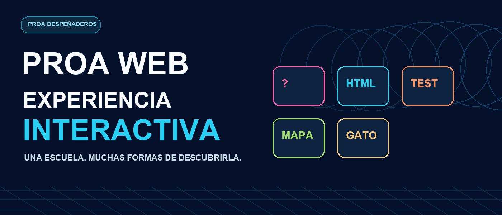

<div align="center">




# PROA Web · Experiencia Interactiva

**Una página para conocer la escuela. Un montón de formas de vivirla.**

[🏠 Ir a PROA Web](https://alvaroespinozaproa.github.io/Experiencia-Interactiva/) &nbsp; · &nbsp; [🎮 Elegir una experiencia](https://alvaroespinozaproa.github.io/Experiencia-Interactiva/experiencia-interactiva/)

</div>

---

## 💙 Todo empezó con PROA Web

**PROA Web es la base de todo este proyecto.** La página nació para mostrar nuestra escuela de Despeñaderos: sus espacios, su propuesta educativa y los proyectos que hacen los estudiantes. Ahí están el inicio, la sección institucional, el plano y la vidriera de proyectos.

A partir de esa página surgió una idea para el evento: además de leer sobre la escuela, ¿por qué no poder **jugar, aprender y recorrerla**? Así nació la sección **Experiencia Interactiva**, que reúne distintas ideas en un mismo lugar. Cada una tiene sus colores, su forma de jugar y algo de lo que somos en PROA.

> De una página para conocer la escuela a un espacio para descubrirla jugando.

[**Conocer PROA Web →**](https://alvaroespinozaproa.github.io/Experiencia-Interactiva/)

---

<div align="center">

## ✨ Elegí tu misión

**Preguntas · Memoria · Código · Bloques · Aventura**

</div>

### 🎤 01 / PROA: El desafío

Cinco preguntas, opciones y puntos. Un juego para poner a prueba lo que sabés de PROA, la tecnología y el trabajo en equipo. Está pensado como una partida corta, con un estilo de concurso para jugar y compartir.

**[Jugar al desafío →](https://alvaroespinozaproa.github.io/Experiencia-Interactiva/experiencia-interactiva/desafio/)**

---

### 🃏 02 / Memotest de HTML

Antes de entrar al test hay un desafío de memoria: encontrar las parejas de etiquetas HTML. Cada acierto va dejando una explicación para conocer qué hace cada una, desde `<html>` y `<body>` hasta los enlaces y las imágenes.


**[Abrir el desafío de HTML →](https://alvaroespinozaproa.github.io/Experiencia-Interactiva/experiencia-interactiva/desafio-html/)**

---

### 🦠 03 / Test HTML · Modo virus

Después de la memoria, el archivo cambia: aparecen las interferencias y empieza otra prueba. Hay que responder preguntas de verdadero o falso sobre HTML mientras corre el tiempo. La transición une las dos etapas, como si el archivo de memoria se hubiera infectado.


**[Entrar al desafío HTML →](https://alvaroespinozaproa.github.io/Experiencia-Interactiva/experiencia-interactiva/desafio-html/)**

---

### 🧱 04 / PROA en bloques

Nuestra escuela también tiene un lugar en Minecraft. Desde esta sección podés mirar el tráiler, abrir la carpeta del mundo y encontrar las instrucciones, los mods y las coordenadas para recorrer el mapa.


**[Explorar PROA en bloques →](https://alvaroespinozaproa.github.io/Experiencia-Interactiva/experiencia-interactiva/recorrido-en-bloques/)**

---

### 🐈 05 / Escape PROA

Un gatito gris está perdido y necesita ayuda para encontrar la salida. El camino pasa por el patio, el pasillo y el taller: en cada espacio hay objetos para observar, acertijos para resolver y llaves que encontrar.

La aventura se fue construyendo y puliendo con sus propios escenarios, movimientos y diálogos. La intención fue que los mecanismos fueran parte de la escuela y que el gato tuviera una historia, no solo una salida por encontrar.

<details>
<summary>🐾 Abrir el final de la historia · contiene spoilers</summary>

Después de recorrer las habitaciones, el gatito encuentra a alguien que lo recibe y está dispuesto a cuidarlo. La aventura termina con compañía, un lugar seguro y el comienzo de una nueva vida.

</details>

**[Acompañar al gatito →](https://alvaroespinozaproa.github.io/Experiencia-Interactiva/experiencia-interactiva/escape-proa/)**

---

## 🛠️ Un poco de lo que hay detrás

El proyecto fue creciendo con las ideas, propuestas y revisiones de la presentación: desde la página institucional y el plano hasta los juegos, las transiciones, los escenarios y el recorrido en bloques. Cada experiencia se trabajó con una identidad propia, pero conectada con la misma escuela.

Esta versión está preparada para **GitHub Pages** y usa **HTML, CSS y JavaScript**, además de GSAP para algunas animaciones. Las imágenes, los sonidos y demás recursos están en `static`.

Para probarla en tu computadora, abrí una terminal en esta carpeta y ejecutá:

```bash
python -m http.server 8000
```

Después entrá a `http://localhost:8000/`. El formulario de contacto y los menús PAICOR necesitan un servidor y una base de datos, por eso no están habilitados en esta versión estática.

---

<div align="center">

### PROA Web 💙

**Conocer la escuela. Crear ideas. Aprender jugando.**

[Volver al inicio](https://alvaroespinozaproa.github.io/Experiencia-Interactiva/) · [Ver las experiencias](https://alvaroespinozaproa.github.io/Experiencia-Interactiva/experiencia-interactiva/)

</div>
